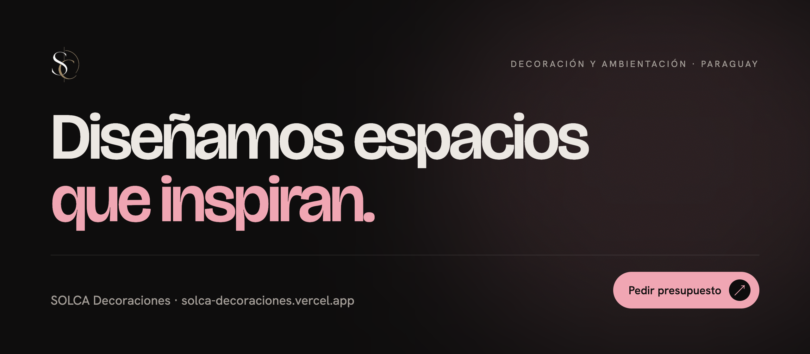
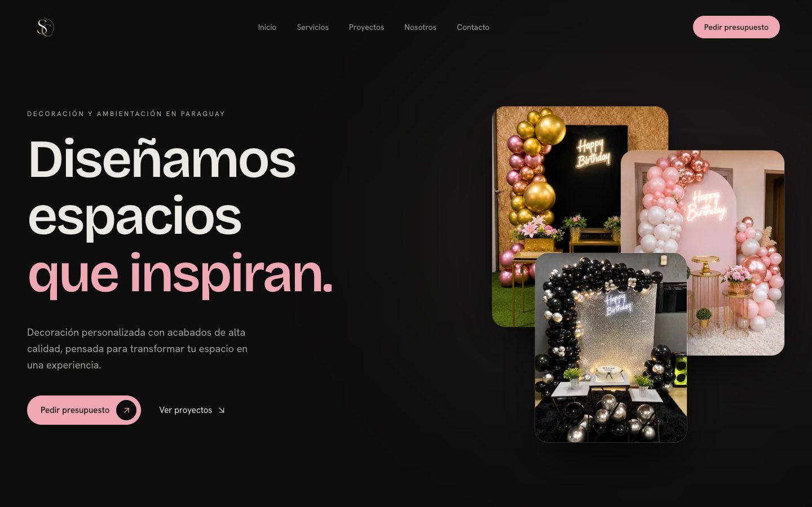
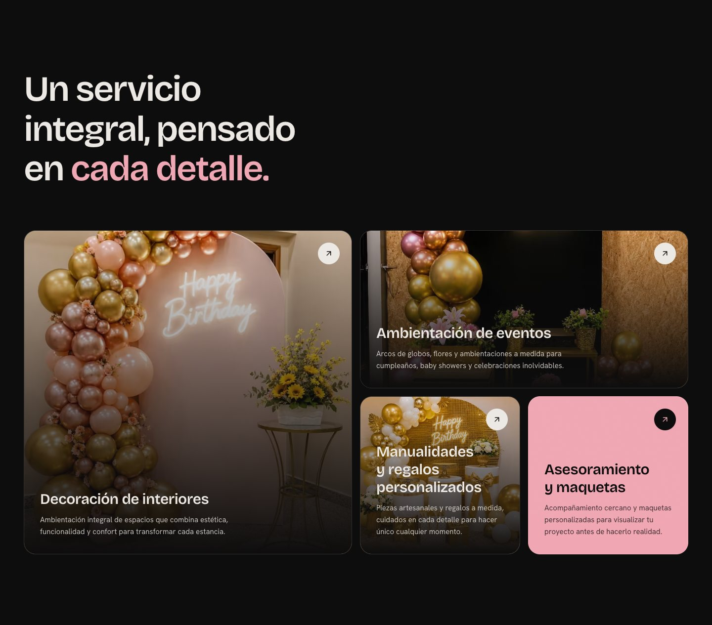
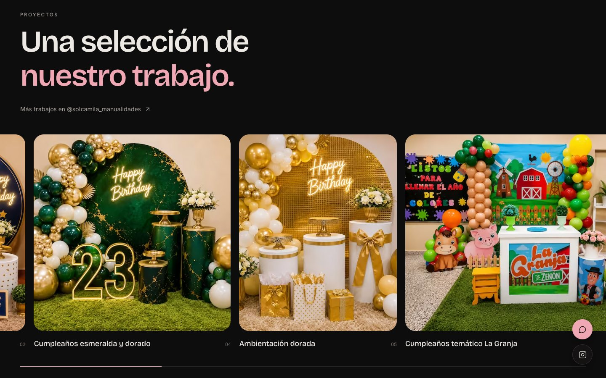
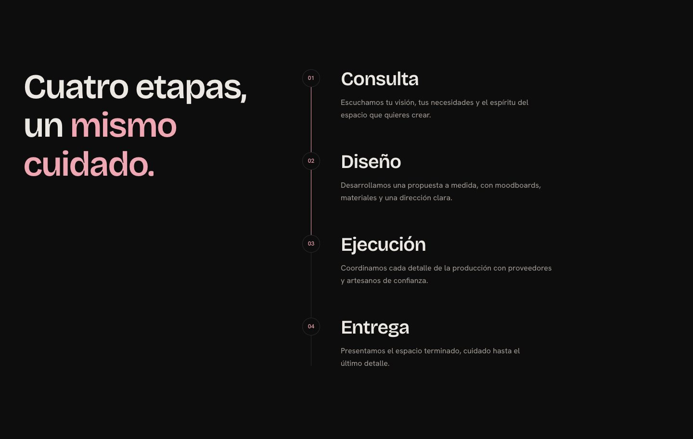
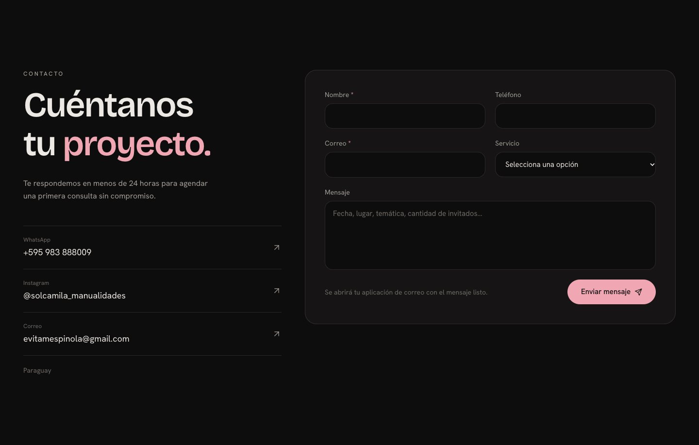
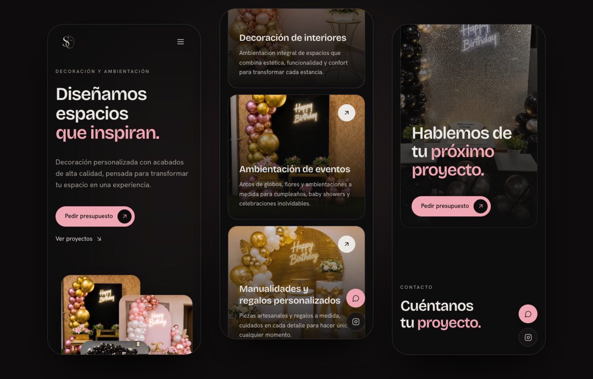
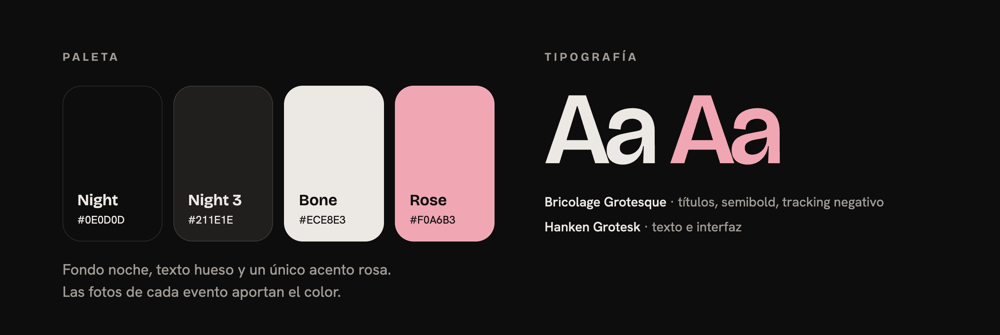

<p align="center">
  
</p>

<p align="center">
  <a href="https://solca-decoraciones.vercel.app"></a>
  <a href="https://github.com/ivanvera7/Solca-decoraciones/actions/workflows/ci.yml"></a>
</p>

<p align="center">
  
  
  
  
  
</p>

<br>

Página web de **SOLCA Decoraciones**, un estudio de decoración y ambientación en Paraguay:
decoración de interiores, arcos de globos y eventos, manualidades, regalos personalizados y
maquetas a medida.

Una sola página, oscura y fotográfica: el color lo ponen los trabajos reales de cada evento.

<br>

## La web

<p align="center">
  
</p>

<table>
  <tr>
    <td width="50%"></td>
    <td width="50%"></td>
  </tr>
  <tr>
    <td width="50%"></td>
    <td width="50%"></td>
  </tr>
</table>

<p align="center">
  
</p>

<br>

## Identidad visual

<p align="center">
  
</p>

| Token | Color | Uso |
| --- | --- | --- |
| `night` | `#0E0D0D` | Fondo de toda la página |
| `night-2` / `night-3` | `#161414` / `#211E1E` | Tarjetas, formulario, estados hover |
| `bone` | `#ECE8E3` | Texto principal |
| `bone-muted` / `bone-faint` | `#A39D97` / `#6E6965` | Texto secundario y metadatos |
| `rose` | `#F0A6B3` | El único acento: CTAs, palabras destacadas, progreso |
| `line` | `rgba(236,232,227,.12)` | Bordes y separadores |

- **Tipografía:** Bricolage Grotesque en semibold con tracking negativo para títulos; Hanken
  Grotesk para texto e interfaz.
- **Formas:** botones en píldora, fotos y tarjetas con `rounded-3xl`, campos con `rounded-2xl`.
- **Movimiento:** titulares que suben palabra a palabra, manifiesto que se ilumina con el
  scroll, galería horizontal fijada, línea de proceso que se rellena y CTA que crece hasta
  ocupar el ancho. Todo respeta `prefers-reduced-motion`.
- **Puntero:** siempre el nativo. En la galería aparece una burbuja "Ver" que lo sigue sin
  retraso.

<br>

## Desarrollo

Requiere **Node 24** (`.nvmrc`) y **npm**.

```bash
npm ci
npm run dev     # http://localhost:3000
npm run check   # lint + tipos + tests
npm run build   # build de producción
```

El contenido (textos, servicios, galería y datos de contacto) vive en
[`lib/constants.ts`](lib/constants.ts). Para sumar una foto a la galería, guárdala como
`public/images/work-N.jpg` y añádela a `GALLERY`: los tests comprueban que exista.

```
app/              layout, metadatos, página 404, robots y sitemap
components/       una sección por archivo (hero, services, gallery, process, contact...)
components/ui/    piezas compartidas (Button, RevealText, ScrollWords, Magnetic...)
lib/constants.ts  todo el contenido del sitio
tests/            tests de integridad del contenido
```

Convenciones, comandos y reglas para agentes de IA: [AGENTS.md](AGENTS.md).

<br>

<p align="center">
  <sub>Hecho a mano en Paraguay · <a href="https://www.instagram.com/solcamila_manualidades">@solcamila_manualidades</a></sub>
</p>
